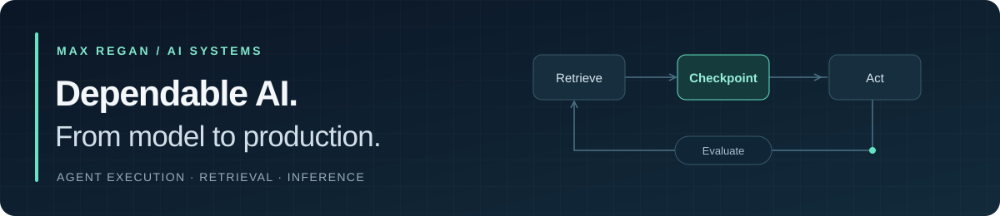

  

# Hi, I'm Max.

**Software Engineer · AI Systems & ML Infrastructure**  
## Selected projects

### Agent execution, retrieval & inference

**[durableflow](https://github.com/maxgregaabig/durableflow) — What survives when an agent crashes?**  
A Python/SQLite lab for checkpoints, persistent approvals, model fallback, and failure injection. My repository includes a [merged workshop curriculum](https://github.com/maxgregaabig/durableflow/pull/2) with exercises and capstones that make those mechanics easier to explore. Based on [Marcos Polanco's DurableFlow](https://github.com/marcospolanco/durableflow).

**[pgvector-rag](https://github.com/maxgregaabig/pgvector-rag) — Retrieval with inspectable evidence.**  
A FastAPI document-search service with PostgreSQL/pgvector, Redis caching, chunk-level citations, and an evaluation harness. Deterministic providers make the core behavior testable without API keys. An exploration of [H4mid2019's project](https://github.com/H4mid2019/pgvector-rag).

**[model-serving-stack](https://github.com/maxgregaabig/model-serving-stack) — Serving is a systems problem.**  
A reference environment for vLLM, Triton, and Ray Serve, with Kubernetes deployment configurations and GPU observability. The FastAPI gateway targets vLLM; alternative runtimes have separate deployment paths. Based on [TylrDn's serving stack](https://github.com/TylrDn/model-serving-stack).

**[autoresearch](https://github.com/maxgregaabig/autoresearch) — A bounded loop for autonomous experimentation.**  
Exploring [Andrej Karpathy's autoresearch](https://github.com/karpathy/autoresearch): an agent edits training code, runs a fixed-budget experiment, evaluates the result, and keeps or reverts the change. The interesting boundary is the experiment contract: what may change, what stays fixed, and what counts as improvement.

### Developer tools

| Project | What it makes visible |
| --- | --- |
| **[FlakeLedger](https://github.com/maxgregaabig/FlakeLedger)** | Flaky tests across reruns of the same commit, with a transparent model for retry compute and developer waiting costs. Python; offline JUnit XML analysis. |
| **[ReviewTide](https://github.com/maxgregaabig/ReviewTide)** | Review waiting times and code-ownership concentration from PR and Git exports. Reports sample sizes and process bottlenecks without ranking individual productivity. Python; offline analysis. |
